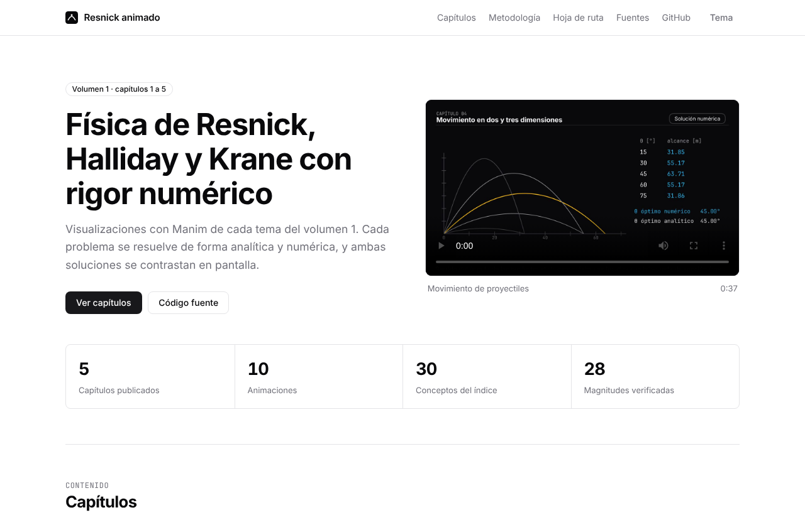
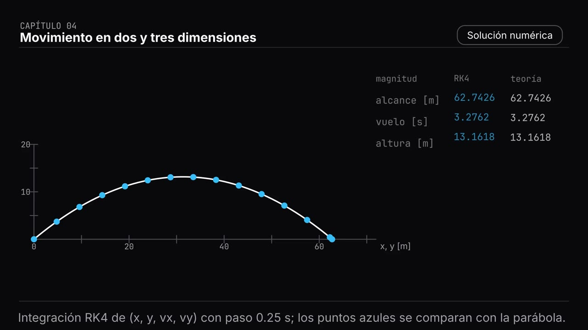
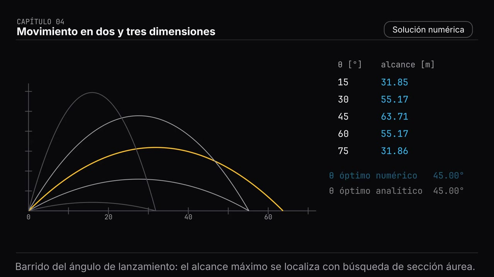
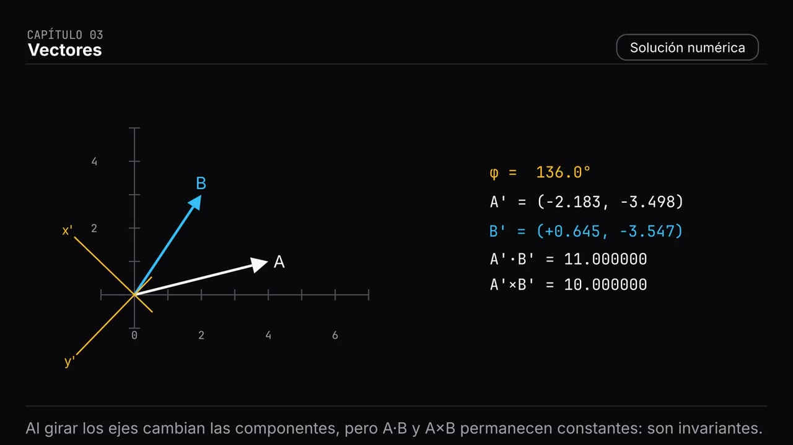
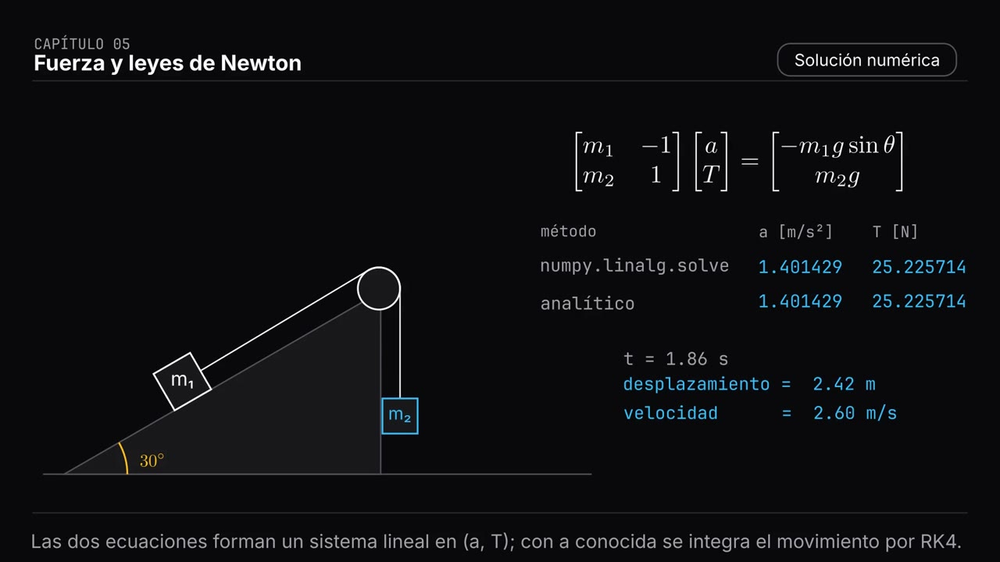
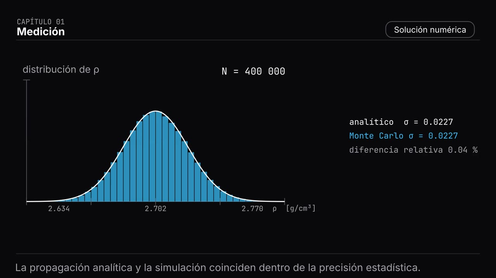
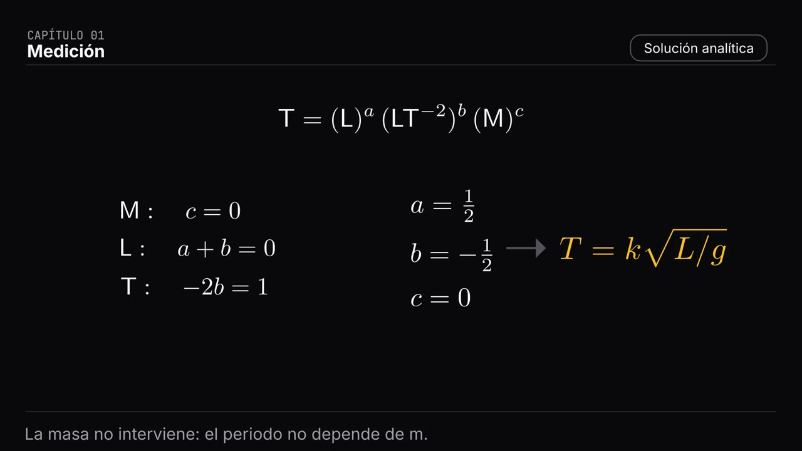
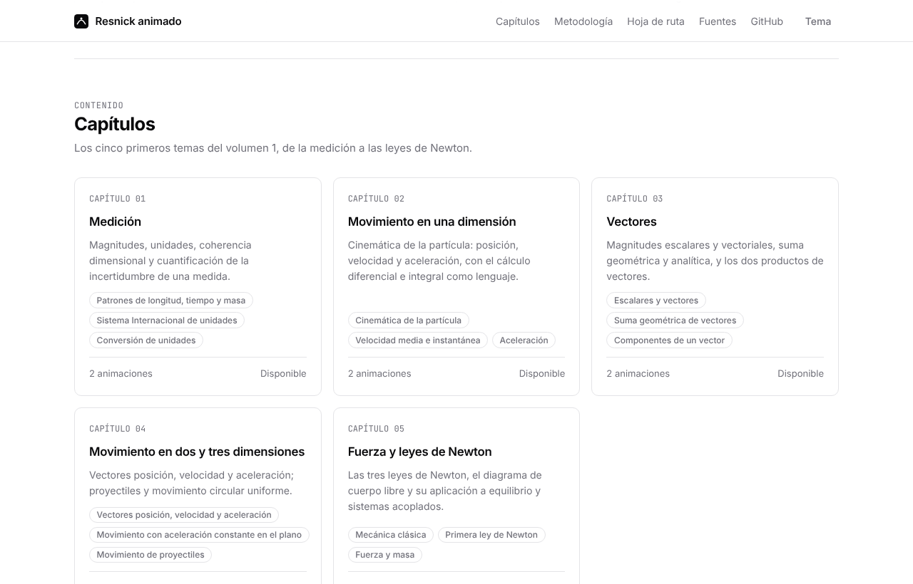
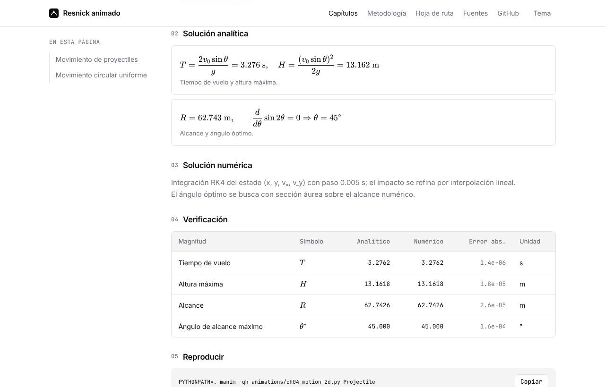
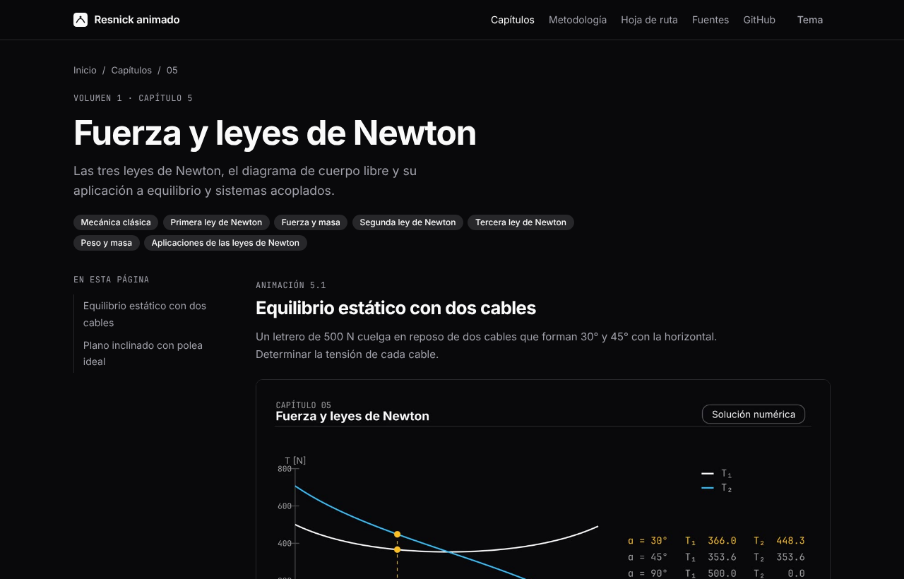

# Resnick animado

[](https://github.com/Ironsss/resnickanimado/actions/workflows/pages.yml)
[](LICENSE)

Visualización con [Manim](https://www.manim.community/) [10] de los temas de *Física* de Resnick, Halliday y Krane [1][2], con solución analítica y numérica de cada problema.

**Sitio:** <https://ironsss.github.io/resnickanimado/>

**Autor:** David Alexis García Espinosa · [LinkedIn](https://www.linkedin.com/in/davidalexisge) · [Perfil en la Facultad de Ciencias, UNAM](https://www.fciencias.unam.mx/directorio/93391)



## Contenido

1. [Objetivo](#objetivo)
2. [Estado de cobertura](#estado-de-cobertura)
3. [Vista previa](#vista-previa)
4. [Cómo funciona](#cómo-funciona)
5. [Estructura del repositorio](#estructura-del-repositorio)
6. [Instalación y uso](#instalación-y-uso)
7. [Añadir un capítulo](#añadir-un-capítulo)
8. [Despliegue](#despliegue)
9. [Diseño](#diseño)
10. [Alcance y atribución](#alcance-y-atribución)
11. [Referencias](#referencias)
12. [Cómo citar](#cómo-citar)
13. [Licencia](#licencia)

## Objetivo

Cada tema del índice de conceptos del libro [1][2] se resuelve con tres capas:

1. **Fundamentos.** Definiciones y leyes, con su notación.
2. **Solución analítica.** Deducción en forma cerrada, paso a paso.
3. **Solución numérica.** Un método independiente cuyo resultado se contrasta con el analítico.

La meta es cubrir los volúmenes 1 y 2. Los números que muestran los videos y el sitio se calculan con las mismas funciones que se prueban automáticamente: si el método numérico y la solución exacta divergen más allá de la tolerancia esperada, las pruebas fallan.

## Estado de cobertura

Los 50 temas del índice de los volúmenes 1 y 2 están publicados, con dos escenas por tema (100 animaciones). La lista por capítulo, con sus conceptos, está en [`docs/ROADMAP.md`](docs/ROADMAP.md).

| Parte | Temas | Ejemplos de métodos numéricos |
| --- | --- | --- |
| Vol. 1. Mecánica clásica | Capítulos 1 a 17: medición, vectores, cinemática, leyes de Newton, energía, colisiones, rotación, gravitación, fluidos | RK4 y Euler [4][5], Verlet, Monte Carlo [6], sección áurea [7], Simpson, bisección, sistemas lineales |
| Vol. 1. Oscilaciones y ondas | Capítulos 18 a 21: oscilaciones, ondas, sonido, relatividad especial | RK4, diferencias finitas (leapfrog), autovalores, FFT con ventana de Hann, Monte Carlo, matrices de Lorentz |
| Vol. 1. Termodinámica | Capítulos 22 a 25: temperatura, primera ley, teoría cinética, entropía | RK4, Simpson sobre ciclos, Monte Carlo de gases, simulación de partículas independientes |
| Vol. 2. Electromagnetismo | Capítulos 1 a 14: Coulomb, Gauss, potencial, circuitos, campo magnético, inducción, Maxwell | Relajación SOR, Biot-Savart numérico, Boris, diferencias finitas de Yee (FDTD), detección síncrona |
| Vol. 2. Óptica | Capítulos 15 a 18: Snell y Fermat, lentes, interferencia, difracción y polarización | Trazado exacto de rayos, matrices ABCD y de transferencia, suma coherente, cálculo de Jones |
| Vol. 2. Física cuántica y moderna | Capítulos 19 a 25: cuerpo negro, ondas de materia, Schrödinger, hidrógeno, bandas, núcleo, cosmología | Diagonalización de hamiltonianos, RK4 de la ecuación estacionaria, FFT, Monte Carlo, ondas planas |

La numeración sigue el orden del índice del proyecto, no necesariamente el de cada edición del libro. Cada escena enfrenta una solución analítica con un método numérico independiente y publica las dos columnas con su error.

El análisis dimensional sigue el planteamiento de Buckingham [8] y la propagación de incertidumbre, la guía GUM [9].

## Vista previa

Escenas renderizadas con Manim, a partir de los videos del sitio.

| | |
| --- | --- |
|  |  |
| **Proyectiles.** Integración RK4 sobre la solución analítica. | **Proyectiles.** El ángulo de alcance máximo se localiza por sección áurea. |
|  |  |
| **Vectores.** A·B y A×B no cambian al rotar los ejes. | **Newton.** Sistema lineal en (a, T) e integración del movimiento. |
|  |  |
| **Medición.** Monte Carlo frente a propagación analítica. | **Medición.** Exponentes por coherencia dimensional. |

Páginas del sitio:

| | |
| --- | --- |
|  |  |
| Capítulos con su índice de conceptos. | Tabla de verificación: valor analítico, numérico y error. |



## Cómo funciona

Cada escena sigue las mismas cuatro fases: Fundamentos, Problema, Solución analítica y Solución numérica. El flujo de datos es de un solo sentido:

```
physics/  --->  animations/  --->  media/videos/*.mp4  --->  scripts/build_site.py  --->  public/
   |                                                              ^
   +--------------------->  content/  ----------------------------+
```

- `physics/` calcula cada problema por vía analítica y por un método numérico independiente.
- `animations/` anima esos resultados; no recalcula nada por su cuenta.
- `content/` reúne enunciados, ecuaciones y la tabla de verificación, calculada en la construcción con `physics/`.
- `scripts/build_site.py` genera el sitio estático con los videos, los fotogramas de portada y las ecuaciones con KaTeX [13].

### Métodos numéricos empleados

| Método | Uso | Referencia |
| --- | --- | --- |
| Runge-Kutta de cuarto orden | Movimiento de proyectiles, péndulo, caída libre | [4][5] |
| Euler explícito | Comparación de orden de convergencia con RK4 | Método estándar |
| Monte Carlo | Incertidumbre de la densidad; área del paralelogramo | [6] |
| Sección áurea | Ángulo de alcance máximo | [7] |
| Mínimos cuadrados (SVD) y solución de sistemas lineales | Exponentes dimensionales; tensiones y aceleraciones | NumPy [12] |
| Diferencias finitas y bisección | Velocidad, aceleración y ángulo de equilibrio | Métodos estándar |

## Estructura del repositorio

```
physics/        Soluciones analíticas y numéricas por capítulo. No depende de Manim.
animations/     Escenas de Manim y sistema visual compartido (common.py).
content/        Texto, ecuaciones, filas de verificación y fuentes.
web/assets/     Hojas de estilo y scripts del sitio.
scripts/        Renderizado de escenas, generación del sitio y de la hoja de ruta.
tests/          Pruebas que comparan solución analítica y numérica.
docs/           Hoja de ruta e imágenes del README.
.github/        Flujo de trabajo de pruebas, renderizado y despliegue.
```

## Instalación y uso

Requisitos: Python 3.10 o superior, FFmpeg [17], una distribución de LaTeX con `dvisvgm`, y las bibliotecas Cairo y Pango. Las tipografías Inter [14] y JetBrains Mono [15] son opcionales; sin ellas Manim usa una de reserva.

En Debian y Ubuntu:

```bash
sudo apt-get install ffmpeg libcairo2-dev libpango1.0-dev pkg-config \
  texlive-latex-base texlive-latex-extra texlive-fonts-recommended dvisvgm \
  fonts-inter fonts-jetbrains-mono
```

Entorno y ejecución:

```bash
python -m venv .venv && source .venv/bin/activate
pip install -r requirements.txt

# Comprobar que cada solución numérica coincide con la analítica
python -m pytest -q

# Renderizar una escena en baja calidad
PYTHONPATH=. manim -ql animations/ch04_motion_2d.py Projectile

# Renderizar todo (1080p, 30 fps) y construir el sitio
python scripts/render_all.py
python scripts/build_site.py
python -m http.server --directory public 8000
```

`python scripts/render_all.py --low` renderiza a 480p y 15 fps para iterar con rapidez. Pasar un identificador de capítulo (`ch02`) limita el renderizado a ese capítulo.

## Añadir un capítulo

1. Crear `physics/chNN_<tema>.py` con la solución analítica y un método numérico independiente para cada problema.
2. Añadir pruebas en `tests/` con una tolerancia justificada por el método.
3. Crear `animations/chNN_<tema>.py` con una clase por escena que herede de `PhysicsScene`.
4. Declarar el capítulo, sus escenas y las filas de verificación en `content/chapters.py`, y actualizar `content/references.py` si se usan fuentes nuevas.
5. Renderizar, revisar los fotogramas y ejecutar `python scripts/build_site.py`.

Los criterios de aceptación están en [`docs/ROADMAP.md`](docs/ROADMAP.md).

## Despliegue

El flujo [`pages.yml`](.github/workflows/pages.yml) se ejecuta en cada push a `main`: pasa las pruebas, renderiza las animaciones a 1080p, genera el sitio y lo publica con GitHub Pages. Requiere que en *Settings > Pages* el origen sea **GitHub Actions**.

## Diseño

El sitio y los videos comparten un sistema visual sobrio inspirado en [shadcn/ui](https://ui.shadcn.com/) [16]: escala neutra zinc, bordes finos, tipografía Inter, tema claro y oscuro. No se usa código de shadcn/ui, solo se toma como referencia de diseño. En los videos, el blanco indica la solución analítica, el azul la numérica, el rojo el error y el ámbar el resultado destacado.

## Alcance y atribución

- El proyecto es independiente y no está afiliado a los autores ni a los editores del libro.
- El índice de temas del libro [1][2][3] sirve de guía de cobertura. Los temas se identifican por título, porque la numeración de capítulos varía entre ediciones y puede diferir de la del sitio.
- No se reproducen textos, figuras ni problemas del libro. Los enunciados, datos y soluciones son originales y se cotejan numéricamente.
- Los resultados físicos de cada escena son deducciones estándar de la mecánica clásica; el libro [1] es la referencia de contenido, no la fuente de los textos del sitio.

## Referencias

**Texto de referencia**

[1] R. Resnick, D. Halliday y K. S. Krane, *Physics*, vol. 1, 5.ª ed. Nueva York: John Wiley & Sons, 2002. ISBN 978-0-471-32057-9.

[2] R. Resnick, D. Halliday y K. S. Krane, *Physics*, vol. 2, 5.ª ed. Nueva York: John Wiley & Sons, 2002. ISBN 978-0-471-40194-0.

[3] R. Resnick, D. Halliday y K. S. Krane, *Física*, vol. 1, 4.ª ed. en español. México: Compañía Editorial Continental, 2002. ISBN 970-24-0257-3.

**Métodos**

[4] C. Runge, «Über die numerische Auflösung von Differentialgleichungen», *Mathematische Annalen*, vol. 46, pp. 167-178, 1895.

[5] W. Kutta, «Beitrag zur näherungsweisen Integration totaler Differentialgleichungen», *Zeitschrift für Mathematik und Physik*, vol. 46, pp. 435-453, 1901.

[6] N. Metropolis y S. Ulam, «The Monte Carlo method», *Journal of the American Statistical Association*, vol. 44, n.º 247, pp. 335-341, 1949.

[7] J. Kiefer, «Sequential minimax search for a maximum», *Proceedings of the American Mathematical Society*, vol. 4, n.º 3, pp. 502-506, 1953.

[8] E. Buckingham, «On physically similar systems; illustrations of the use of dimensional equations», *Physical Review*, vol. 4, n.º 4, pp. 345-376, 1914.

[9] JCGM 100:2008, *Evaluation of measurement data: Guide to the expression of uncertainty in measurement* (GUM). BIPM, 2008.

**Software y diseño**

[10] The Manim Community Developers, *Manim: Mathematical Animation Framework*, v0.22.0. <https://www.manim.community/>

[11] G. Sanderson (3Blue1Brown), *manim*, versión original. <https://github.com/3b1b/manim>

[12] C. R. Harris et al., «Array programming with NumPy», *Nature*, vol. 585, pp. 357-362, 2020. doi:10.1038/s41586-020-2649-2.

[13] KaTeX. <https://katex.org/>

[14] R. Andersson, *Inter*. <https://rsms.me/inter/>. Licencia SIL OFL.

[15] JetBrains, *JetBrains Mono*. <https://www.jetbrains.com/lp/mono/>. Licencia SIL OFL.

[16] shadcn, *shadcn/ui*. <https://ui.shadcn.com/>

[17] FFmpeg. <https://ffmpeg.org/>

Los datos bibliográficos de [1], [2] y [3] (ISBN y año) se contrastaron con catálogos bibliotecarios y con el catálogo del editor. El ISBN de una reimpresión concreta puede diferir; compruebe el de su ejemplar. Las referencias [4] a [9] y [11] a [17] se citan según su publicación original o sitio oficial.

## Cómo citar

Si usa este material, cite el proyecto y, para el contenido de referencia, el texto original [1][2]:

```bibtex
@software{resnickanimado,
  title  = {Resnick animado: visualizaciones con Manim y verificaci{\'o}n num{\'e}rica},
  author = {García Espinosa, David Alexis},
  year   = {2026},
  url    = {https://github.com/Ironsss/resnickanimado},
  note   = {Licencia MIT}
}
```

GitHub muestra también esta información a partir de [`CITATION.cff`](CITATION.cff).

## Licencia

Código y contenido propio bajo licencia MIT. Véase [`LICENSE`](LICENSE). Las tipografías Inter y JetBrains Mono se distribuyen bajo SIL OFL; KaTeX y Manim, bajo sus licencias respectivas.
